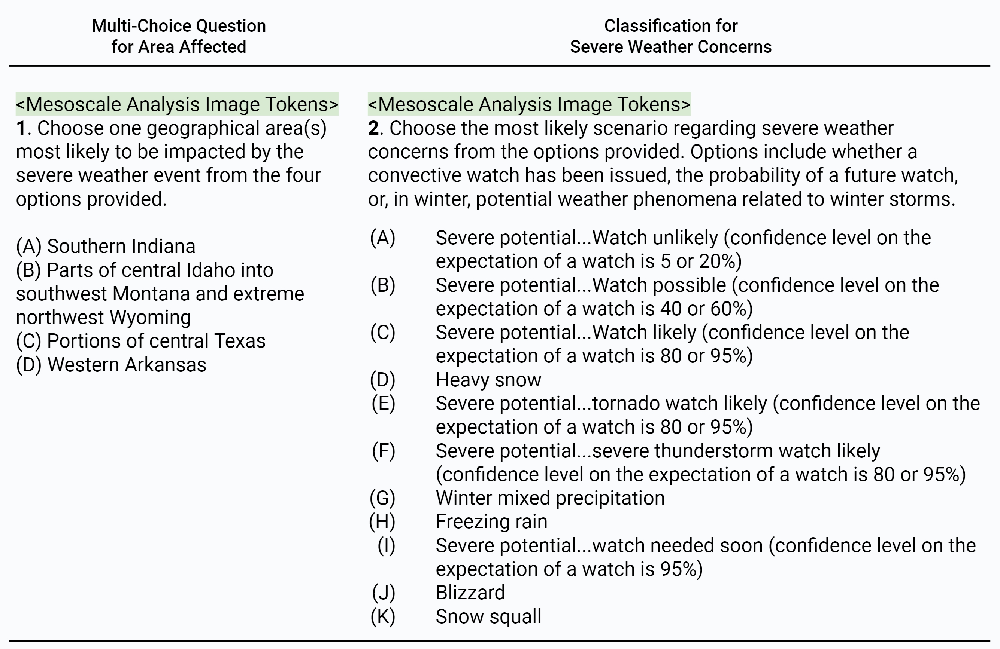

# WeatherQA Dataset Description
WeatherQA is the first multimodal dataset designed for machines to reason about complex combinations of weather parameters and predict severe weather in real-world scenarios.\
Link to the paper: [WeatherQA: Can Multimodal Language Models Reason about Severe Weather?](https://arxiv.org/abs/2406.11217)

Each entry of WeatherQA includes:
- A set of 20 images from the [Mesoscale Analysis Archive](https://www.spc.noaa.gov/exper/ma_archive/)
- An annotation from [Mesoscale Discussion](https://www.spc.noaa.gov/products/md/) describing the weather conditions and potential severe weather threats
- The data is licensed under the copyright of [NOAA](https://www.noaa.gov/)


## Updates

*   **2025-03-31:** 🔥 We've released the `WeatherQA_SFT` dataset, specifically formatted for supervised fine-tuning, on Hugging Face! You can find details and usage instructions in the [Fine-tuning Dataset: WeatherQA_SFT](#fine-tuning-dataset-weatherqa_sft) section below. Additionally, the benchmark tables have been updated with the latest zero-shot results, including a **fine-tuned `Qwen2.5-VL-3B`** comparison against a range of state-of-the-art proprietary and open-source models.

## WeatherQA Dataset

#### Texts:

* [Raw Dataset (Mesoscale Discussion): WeatherQA](https://drive.google.com/file/d/1GpEp6EFrCA6wqU6FEHsaMO7jwTckP_m4/view?usp=sharing)

* [Train/Test MCQ Dataset: WeatherQA_SFT](https://huggingface.co/datasets/ZhanxiangHua/WeatherQA_SFT) preprocessed SFT ShareGPT dataset on Huggingface 

* [Train MCQ_ShareGPT Json](https://drive.google.com/file/d/1eXPgH0uQGNDaIgDp2wxHtA4gGqAvQiye/view?usp=sharing) use with "Train: 2014-2019 Mesoscale Analysis Dataset" below for SFT

* [Test MCQ Dataset: Direct](https://drive.google.com/drive/folders/1fNyLOEiQ1R8sLWPQoq8RJVGwJoZBoqo0?usp=sharing)

* [Test MCQ Dataset: CoT](https://drive.google.com/drive/folders/1A9Ij3qB0uVi-Tydwue1KMRM2OKKf7ssW?usp=sharing)

#### Images:

* [Train: 2014-2019 Mesoscale Analysis Dataset](https://drive.google.com/file/d/1mViaf1f-sWB1DyfCrw-NwmZp4gj96mYr/view?usp=drive_link) roughly 10GB

* [Test: 2020 Mesoscale Analysis Dataset](https://drive.google.com/file/d/17Hfv2NOLpy6rJBUrghaZmU_7r6WDCuDs/view?usp=sharing) roughly 1.5GB  

#### Example of a Sample in the WeatherQA Dataset

```json
{
  "2018_md0398": {
    "para_paths": [
      "./md_image/2018/shr6/md0398_20180513_17_shr6.gif",
      "./md_image/2018/scp/md0398_20180513_17_scp.gif",
      "./md_image/2018/tadv/md0398_20180513_17_tadv.gif",
      "./md_image/2018/lclh/md0398_20180513_17_lclh.gif",
      "./md_image/2018/epvl/md0398_20180513_17_epvl.gif",
      "./md_image/2018/laps/md0398_20180513_17_laps.gif", 
      "./md_image/2018/mcsm/md0398_20180513_17_mcsm.gif",
      "./md_image/2018/rgnlrad_cropped/md0398_20180513_17_rgnlrad.gif",
      "./md_image/2018/mcon/md0398_20180513_17_mcon.gif",
      "./md_image/2018/ttd/md0398_20180513_17_ttd.gif",
      "./md_image/2018/thea/md0398_20180513_17_thea.gif",
      "./md_image/2018/swbt/md0398_20180513_17_swbt.gif",
      "./md_image/2018/stor/md0398_20180513_17_stor.gif",
      "./md_image/2018/lllr/md0398_20180513_17_lllr.gif",
      "./md_image/2018/srh1/md0398_20180513_17_srh1.gif",
      "./md_image/2018/bigsfc_cropped/md0398_20180513_17_bigsfc.gif",
      "./md_image/2018/effh/md0398_20180513_17_effh.gif",
      "./md_image/2018/sbcp/md0398_20180513_17_sbcp.gif",
      "./md_image/2018/fzlv/md0398_20180513_17_fzlv.gif",
      "./md_image/2018/pchg/md0398_20180513_17_pchg.gif"
    ],
    "annotations": "Areas affected...portions of southeast OH...northern WV including Panhandle...western MD...southwest PA...northwest VA Concerning...Severe potential...Watch possible Probability of Watch Issuance...60 percent SUMMARY...Isolated to widely scattered thunderstorms may develop this afternoon and move southeast, with a risk for large hail and damaging winds. A tornado or two will also be possible.  A Severe Thunderstorm Watch may be needed prior to 20Z/4 pm EDT.",
    "time": "05 / 13, 17UTC"
  }
}
```
#### Notes:
- **Key (e.g., "2018_md0398")**: This is a unique identifier for the Mesoscale Discussion sample, which includes the year and a serial number.
- **para_paths**: An array of strings, each representing the file path to a weather parameter image. There are 20 image paths in total, each corresponding to different weather parameters.
- **annotations**: A string containing a detailed description of the weather conditions and potential severe weather threats. This includes information about the affected areas, the severe weather potential, and the probability of watch issuance.
- **time**: A string representing the date and time of the weather parameter images entry in UTC converted from time of issuance in the Mesoscale Discussion sample.

### Mesoscale Analysis Dataset (md_image)

[2020 Mesoscale Analysis Dataset](https://drive.google.com/file/d/17Hfv2NOLpy6rJBUrghaZmU_7r6WDCuDs/view?usp=sharing) roughly 1.5GB  

[2014-2019 Mesoscale Analysis Dataset](https://drive.google.com/file/d/1mViaf1f-sWB1DyfCrw-NwmZp4gj96mYr/view?usp=drive_link) roughly 10GB

The Mesoscale Analysis Dataset contains 20 images, including:
- 18 ingredients-based weather parameter images
- One surface observation image
- One composite radar reflectivity image

The dataset is stored in the `md_image/` directory and is organized by:
1. Year (e.g., `2020/`, `2019/`)
2. Weather parameters or ingredients within each year

Each image file follows the naming convention:
```
md<serial_number>_<date_yyyymmdd>_<hour_hh_utc>_<parameter_name>.gif
```

#### Directory Structure

```
md_image/
    ├── 2020/
    │   ├── bigsfc_cropped/
    │   │   └── md0050_20200112_06_bigsfc.gif
    │   │       ...
    │   ├── epvl/
    │   │   └── md0050_20200112_06_epvl.gif
    │   │       ...
    │   ├── lllr/
    │   │   └── md0050_20200112_06_lllr.gif
    │   │       ...
    │   └── rgnlrad_cropped/
    │       └── md0050_20200112_06_rgnlrad.gif
    │           ...
    │       ...    
    └── 2019/
        ├── bigsfc_cropped/
        │   └── md0825_20190525_06_bigsfc.gif
        │        ...
        ├── epvl/
        │   └── md0825_20190525_06_epvl.gif
        │        ...
        ├── lllr/
        │   └── md0825_20190525_06_lllr.gif
        │        ...
        └── rgnlrad_cropped/
            └── md0825_20190525_06_rgnlrad.gif
                ...
            ...
        ...
```

#### Notes:
- Each year directory (e.g., `2020/`, `2019/`) contains subdirectories for different weather parameters.
- Each parameter directory contains image files named according to the specified convention.

## Fine-tuning Dataset: WeatherQA_SFT

For convenience in fine-tuning models for benchmark purpose, a pre-processed version of the WeatherQA dataset, specifically formatted for **Supervised Fine-Tuning (SFT)**, is available on Hugging Face:

*   **Hugging Face Dataset:** [`ZhanxiangHua/WeatherQA_SFT`](https://huggingface.co/datasets/ZhanxiangHua/WeatherQA_SFT)

**Description:**

`WeatherQA_SFT` is designed for fine-tuning vision/multimodal language models. It transforms the original WeatherQA data into image-text pairs suitable for SFT workflows.

*   **Focus:** Severe weather geo-localization and potential hazard analysis over the Contiguous United States (CONUS).
*   **Format:** Each entry pairs a composite weather image (details below) with a text string formatted for instruction-following or question-answering.
*   **Task:** The text prompt guides the model through a two-step multiple-choice question-answering task based on the image:
    1.  **Affected Area Prediction:** Identifying the geographical regions likely to be impacted by severe weather.
    2.  **Severe Convection Classification:** Assessing the potential category or likelihood of severe convective weather events.
*   **Image Composition:** Note that the images used in `WeatherQA_SFT` contains the 20 parameters available in the full `md_image` dataset from **2014 to 2019**. Refer to the Hugging Face dataset viewer or the original paper for specifics on image composition in the SFT dataset.

## Test Dataset Structure
The provided test dataset structure includes the necessary prompt inputs for the multimodal models.
The dataset is designed to help interpret comprehensive figures related to severe weather analysis and forecasting. It includes the following key components:

- **sys_prompt**: The system prompt or instructions provided to the AI assistant.
- **prompt_template**: A template or format for the prompt.
- **para_description**: A short description of the weather parameters being analyzed.
- **samples**: Test data samples

Test Dataset Download Links:
- [Direct](https://drive.google.com/drive/folders/1fNyLOEiQ1R8sLWPQoq8RJVGwJoZBoqo0?usp=sharing)
- [CoT](https://drive.google.com/drive/folders/1A9Ij3qB0uVi-Tydwue1KMRM2OKKf7ssW?usp=sharing)

### Test Data Samples Structure

Each data sample (from 2020) in the `samples` array includes the following fields:

- **md_id**: A unique identifier for the mesoscale discussion sample.
- **para_paths**: A list of paths that contains the weather parameters.
- **time**: A current timestamp of the corresponding weather parameters.
- **choices**: A set of options related to the area affected.
- **area_ans**: The correct option related to a area affected.
- **concern_ans**: The correct option related to a concerning classification.

#### Examples

Below is an example of the few-shot/0-shot test dataset structure in JSON format; the only difference in CoT is in the `prompt_template`:

```json5
{
  "sys_prompt": "As an AI assistant with expertise in severe weather analysis and forecasting, ...",
  "prompt_template": "",
  "para_description": "",
  "samples": [
    {
      "md_id": "",
      "para_paths":,
      "time": "",
      "choices": "",
      "area_ans": "",
      "concern_ans": "",
      "examples":  [     
        {
            "md_id": "",
            "para_paths":,
            "time": "",
            "choices": "",
            "area_ans": "",
            "concern_ans": "",
        },
        // Repeat N times for few-shot, otherwise ignore 'examples' for 0-shot
      ]
    },
    // Up to 600 samples
  ]
}
```
## Benchmark
The benchmark script is designed to evaluate the performance of different proprietary and open-source multimodal language models on WeatherQA.\
The script uses the WeatherQA dataset to test the models' ability to predict the affected area and classify the development potential of severe convection based on the provided images and time from Mesoscale Analysis.



### Benchmark Results

Zero-shot performance of a range of proprietary and open-source models on the WeatherQA benchmark tasks, along with the fine-tuned `Qwen2.5-VL-3B` model.

**Task 1: Zero-shot Accuracy on the Areas Affected QA Task**

| Model | Accuracy |
| :---- | :------- |
| Qwen3-VL-4B (Finetuned) | **67.5%** |
| Gemini 3.0 | **48.0%** |
| GPT-5.2 | 43.5% |
| Gemini 2.0 | 43.2% |
| Gemini Flash 2.0 | 43.17% |
| GPT-5.1 | 43.0% |
| Gemini 2.5 | 41.7% |
| Gemini Flash 2.5 | 41.67% |
| Claude 3.5 Sonnet | 41.50% |
| GPT-4o | 38.17% |
| Gemini Pro 1.5 | 33.56% |
| Gemini 1.5 | 30.7% |
| Qwen2.5 VL 7B | 26.67% |
| InternVL 2 40B | 25.33% |
| InternVL 2 8B | 24.17% |
| InternVL 2 26B | 23.67% |
| GPT-4 Turbo | 23.50% |
| Qwen2 VL 7B | 22.67% |
| Qwen3-VL-4B | 21.5% |
| GPT-4T | 21.3% |
| Claude 3 Opus | 20.67% |
| Phi 3.5 Vision | 20.00% |
| Qwen2.5 VL 3B | 16.33% |

**Task 2: Zero-shot Accuracy on the Severe Weather Concern Classification Task based on correctly identified Areas Affected**

| Model | Accuracy |
| :---- | :------- |
| Qwen3-VL-4B (Finetuned) | **53.6%** |
| Gemini 3.0 | **21.5%** |
| GPT-5.1 | 18.6% |
| GPT-5.2 | 14.6% |
| Gemini Flash 2.0 | 12.50% |
| Gemini 2.0 | 12.5% |
| Gemini 1.5 | 10.3% |
| Gemini Flash 2.5 | 9.20% |
| Gemini 2.5 | 9.2% |
| Claude 3.5 Sonnet | 8.67% |
| GPT-4T | 8.6% |
| GPT-4o | 5.67% |
| Qwen2.5 VL 7B | 4.37% |
| Qwen3-VL-4B | 3.1% |
| Qwen2.5 VL 3B | 3.06% |
| Qwen2 VL 7B | 3.00% |
| InternVL 2 8B | 3.00% |
| InternVL 2 40B | 3.00% |
| Gemini Pro 1.5 | 2.00% |
| GPT-4 Turbo | 1.83% |
| InternVL 2 26B | 1.83% |
| Claude 3 Opus | 1.33% |
| Phi 3.5 Vision | 1.33% |

*Note: Task 2 evaluations were conducted solely on questions where the Areas Affected answer (Task 1) was correctly identified in the response.*

---

**Fine-tuning Performance: QwenVL2.5-7B**

Performance comparison between the pre-trained (PT) QwenVL2.5-7B model and the model fine-tuned (FT) on WeatherQA_SFT, varying the number of input images provided to the model during inference. **The fine-tuned QwenVL2.5-7B model significantly outperforms the both private and open soure pre-trained models across all input configurations.**

| Input Configuration                | Model State | Area Affected Acc. (Task 1) | Conditional Concern Acc. (Task 2) |
| :--------------------------------- | :---------- | :-------------------------- | :-------------------------------- |
| Single Image (rgnlrad)             | Fine-tuned  | 61.00%                      | 50.55%                            |
|                                    | Pre-trained | 27.50%                      | 3.64%                             |
| **Three Images (rgnlrad, sbcp, shr6)** | Fine-tuned  | **70.33%**                  | **54.98%**                        |
|                                    | Pre-trained | 26.83%                      | 5.59%                             |
| Twenty Images (default setting)                     | Fine-tuned  | 58.00%                      | 46.55%                            |
|                                    | Pre-trained | 26.67%                      | 4.37%                             |

*Note: The "Conditional Concern Accuracy" follows the same condition as noted for Task 2 above.*

### Setup

1. **Clone the repository** (if applicable):
    ```bash
    git clone https://github.com/chengqianma/WeatherQA.git
    cd WeatherQA
    ```

2. **Set up your environment**:
    - Python 3.10 or higher

3. **Install required Python packages**:
    ```bash
    pip install -r benchmark/requirements.txt
    ```

4. **Set up your API key**:
    - Ensure you have your API key ready for the type of model you want to test.
    - Update the `API_KEY` variable in the script with your actual API key.

4. **Prepare your input data**:
    - Mesoscale Analysis Dataset (`md_image` folder) is in the same directory as the `script` folder under `./benchmark`.


### Script Configuration

The script is configured using several variables:

- `MODEL`: Specifies the model to use (`GPT`, `Gemini`, or `Claude`).
- `FEWSHOT`: Boolean flag to indicate whether to use few-shot learning (`true` or `false`).
- `MODEL_ID`: The specific model ID to use.
  - `GPT`: `gpt-4o-2024-05-13`; `gpt-4-turbo-2024-04-09`
  - `Gemini`: `gemini-1.5-flash-latest`; `gemini-1.5-pro-latest`
  - `Claude`: `claude-3-opus-20240229`
- `API_KEY`: Your API key for accessing the model.
- `PROMPT_PATH`: Path to the input JSON file containing the prompts.
- `RESULT_PATH`: Path to the output JSON file where results will be saved.

### Usage

1. **Modify the script**:
    - Set the `MODEL`, `FEWSHOT`, `MODEL_ID`, `API_KEY`, `PROMPT_PATH`, and `RESULT_PATH` variables as needed.

2. **Run the script**:
    ```
    bash ./scripts/test.sh
    ```

### Example

Here is an example configuration:

```bash
MODEL='GPT'
FEWSHOT=true #true for 3-shot, false for 0-shot
MODEL_ID='gpt-4o-2024-05-13'
API_KEY='Your API Key'
PROMPT_PATH=WeatherQA_test_3_shot_mcq_cls_600.json
RESULT_PATH=result.json

```
### SFT (Qwen2.5-VL)

We use [LLaMA-Factory](https://github.com/hiyouga/LLaMA-Factory) to train the Supervised Fine-Tuning (SFT) model. Follow these steps:

1.  **Clone LLaMA-Factory and Install Dependencies:**
    Clone the repository and install the necessary packages. You might also need to install [DeepSpeed](https://github.com/deepspeedai/DeepSpeed) and [vllm](https://github.com/vllm-project/vllm).
    ```bash
    git clone https://github.com/hiyouga/LLaMA-Factory.git
    cd LLaMA-Factory
    pip install -e ".[torch,metrics]"
    ```

2.  **Prepare the Dataset:**
    *   Download the required data sources:
        *   Image Data (Potentially Needed for reference/custom processing): [Train: 2014-2019 Mesoscale Analysis Dataset](https://drive.google.com/file/d/1mViaf1f-sWB1DyfCrw-NwmZp4gj96mYr/view?usp=drive_link)
        *   Training Data (JSON Format): [Train MCQ\_ShareGPT Json](https://drive.google.com/file/d/1eXPgH0uQGNDaIgDp2wxHtA4gGqAvQiye/view?usp=sharing)

    *   Configure your dataset within your LLaMA-Factory data configuration file (e.g., `data/dataset_info.json`) using **one** of the following methods:

        **Method A: Use Local JSON File**
        If you downloaded the `Train MCQ_ShareGPT Json`, add the following entry, replacing `"your-path-to/MCQ_ShareGPT.json"` with the actual file path:
        ```json
        "wqa":{
          "file_name": "your-path-to/MCQ_ShareGPT.json",
          "formatting": "sharegpt",
          "columns": {
            "messages": "conversations",
            "images": "image"
          }
        }
        ```

        **Method B: Use Hugging Face Dataset**
        Alternatively, use the pre-processed `WeatherQA_SFT` dataset directly from Hugging Face with this configuration:
        ```json
        "wqa":{
          "hf_hub_url": "ZhanxiangHua/WeatherQA_SFT",
          "formatting": "sharegpt",
          "columns": {
            "messages": "conversations",
            "images": "image"
          }
        }
        ```

3.  **Configure and Start Training:**
    Modify a training configuration file (e.g., `examples/train/full/qwen2_5_vl_full_sft.yaml`) to match your hardware resources and dataset choice. Then, run the training command:
    ```bash
    llamafactory-cli train path-to-your-training-config-file
    ```
